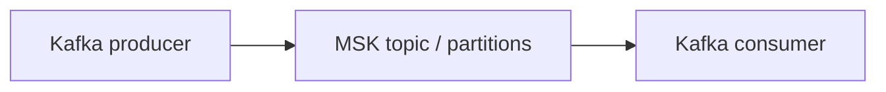
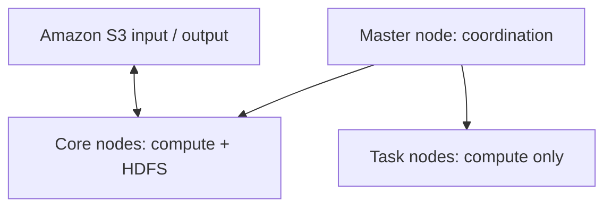
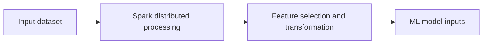

# Conceptual Architecture and Workflow Diagrams

These are **illustrative diagrams based on slide topics**, not deployed or tested AWS architectures. GitHub renders Mermaid diagrams in Markdown.

## Streaming analytics workflow

## Amazon MSK Kafka model

## Amazon EMR cluster roles

## Spark and feature engineering workflow

